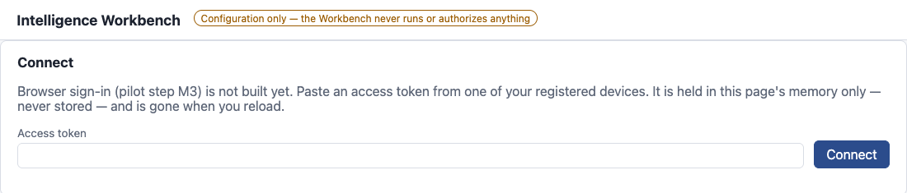
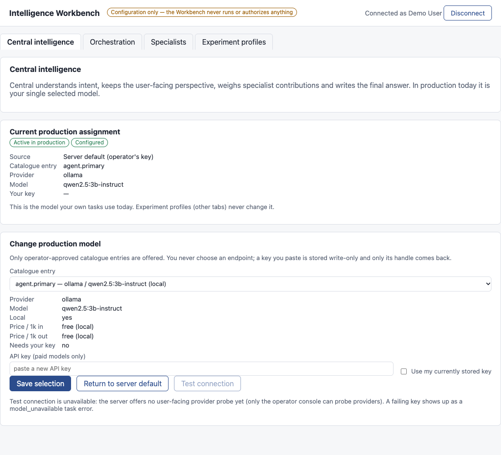
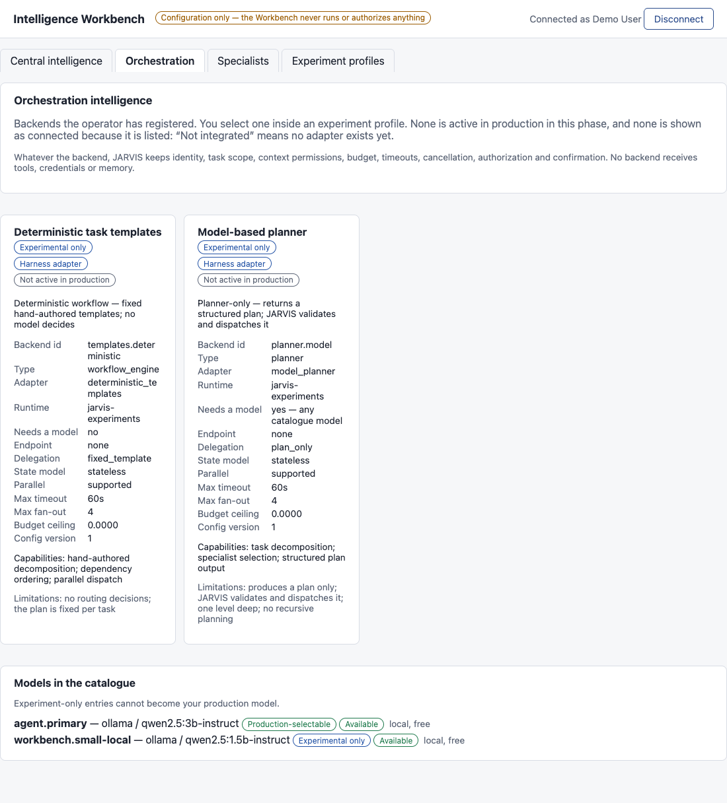
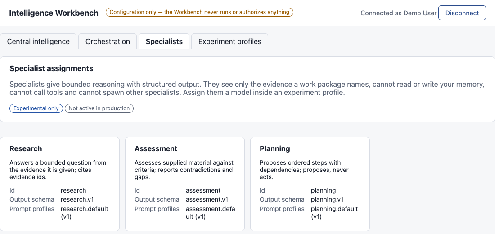
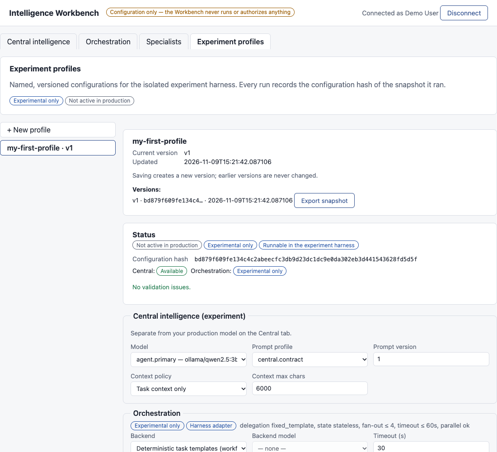

# JARVIS

A self-hosted personal AI assistant in which the model can only *propose* actions. Deterministic code decides what is allowed, and you confirm anything risky.

> **Pre-release. Use disposable or test data only.** The gate for real user data is still closed. See [Limitations](#limitations).

## What it does

Most assistants let a language model act directly, so a bad answer, a prompt injection or a bug can become a real action on your phone, files or accounts. JARVIS splits the two jobs:

```
the model PROPOSES  →  deterministic code AUTHORIZES  →  tools EXECUTE  →  you CONFIRM where risk requires
```

You run the server yourself. You choose the model: a local one through Ollama by default, or a hosted one with your own key where the operator offers one. A task goes in, the model proposes steps, and every step is checked against who you are, what you have granted, and a fixed risk table. Anything consequential pauses on a card showing the exact action, and nothing proceeds until you approve it. Model output is never the security boundary.

## Current capabilities

**Working today** (covered by the automated test suite; not yet exercised on a real phone or against a real Google sign-in end to end):

- **Run tasks through the agent loop.** Submit a task over the API, let the model propose tool calls, authorize each one, pause for confirmation when required, and get a result. Hard ceilings apply to steps, model calls, time and budget. See [docs/RUNNING_RUNTIME.md](docs/RUNNING_RUNTIME.md).
- **Sign in with Google.** Each device holds its own key. Access tokens last 15 minutes and can be revoked immediately.
- **Pick your own model** from the operator's approved list. A key you paste is stored write-only and never appears in a prompt.
- **Constrained execution.** Sandboxed filesystem, default-deny network egress, and `argv`-only restricted process execution. Process confinement needs Linux and runs nothing on macOS.
- **Reminders.** A due reminder delivers a message to your own devices and never executes anything.
- **An Android client** in [`android/`](android/) for tasks, confirmation cards and on-device actions.
- **The Intelligence Workbench**: a browser page at `/ui` for your model choice and for experiment profiles. See [How to use the Workbench](#how-to-use-the-workbench).

**Built but off by default** (the operator turns each on in `config.yaml`): persistent memory and a Git-backed Knowledge Vault, the Agent Factory (owner-private agents, including a sandboxed browser agent), the Judge (evaluation), the Android device channel and push wake, server-side voice providers, and a read-only operator console API.

**Experimental:** the experiment harness in [`experiments/`](experiments/), which tests orchestration ideas on synthetic tasks. Production never imports it.

**Not built:** browser sign-in, a browser chat UI, Darwin, a real `IntelligenceProvider`, account deletion, and integrations with Letta, LangGraph or MCP. Anything not listed above should be treated as absent.

## Quick Start

You need Python 3.11 or later and git. [`uv`](https://github.com/astral-sh/uv) is used below; plain `python -m venv` and `pip` work too. To run tasks you also need a model, by default [Ollama](https://ollama.com) with `qwen2.5:3b-instruct`. The Workbench does not need one. To sign in you need a Google OIDC client; see [Get an access token](#get-an-access-token).

**1. Install**

```bash
git clone https://github.com/harsh-life/JARVIS.git
cd JARVIS
uv venv .venv && source .venv/bin/activate
uv pip install -e ".[dev]"
```

**2. Configure**

```bash
cp config.example.yaml config.yaml      # git-ignored; never commit it
cat >> config.yaml <<'EOF'

workbench:
  enabled: true
EOF
```

Edit `config.yaml` and set `security.oidc.client_id` to your own Google OIDC client id. The Workbench is **off unless you add that `workbench:` block**; `/ui` is served either way, but the Workbench API answers `503` until it is on. Every secret in this file must be a reference such as `env:NAME`; a literal secret stops startup by design.

**3. Create the database and keys**

```bash
export HYPERMIND_DATABASE_URL="sqlite+aiosqlite:///./data/hypermind.db"
mkdir -p data && alembic upgrade head

export HYPERMIND_KEK="$(python3 -m server.secrets.kek)"   # a harmless RuntimeWarning may print
echo "$HYPERMIND_KEK"                                      # store this somewhere durable, outside the repo
```

The key-encryption key protects every stored secret. If you lose it, those secrets cannot be recovered. Each new shell needs both `HYPERMIND_DATABASE_URL` and `HYPERMIND_KEK` exported again. On first run only, create the SecretStore's data key (safe to re-run):

```bash
python3 - <<'PY'
import asyncio
from server.config import load_config
from server.gateway.security import build_security_core, unlock_secret_store
from server.storage import SQLAlchemyStorageBackend

async def main():
    config = load_config()
    storage = SQLAlchemyStorageBackend(config.database_url)
    core = build_security_core(config)
    await unlock_secret_store(core, storage, bootstrap=True)
    await storage.dispose()
    print("SecretStore bootstrapped")

asyncio.run(main())
PY
```

**4. Start the server**

```bash
uvicorn server.composition.main:app --host 127.0.0.1 --port 8000
```

In another terminal, check it:

```bash
curl http://127.0.0.1:8000/api/v1/ready      # {"ready":true,"database":true,"migrations":true,"secrets":true}
```

**5. Open the Workbench** at <http://127.0.0.1:8000/ui/> and connect with an access token.

### Get an access token

Browser sign-in is not built, so the Workbench asks for an access token from a device you have registered. This is the supported route today. It is a developer-style flow, not a consumer login.

Add `http://127.0.0.1:8000/api/v1/auth/oidc/callback` as an authorized redirect URI on your Google OIDC client, then:

```bash
BASE=http://127.0.0.1:8000/api/v1

# 1. Get the Google sign-in URL, open the "redirect_url" in a browser and sign in.
curl -s $BASE/auth/oidc/start
#    The callback page returns {"bootstrap_token": "..."}, valid for 10 minutes.

# 2. Register a device. The server accepts only the platform "android" today, so this
#    creates a stand-in device that is not a phone. The credential is shown once.
curl -s -X POST $BASE/devices -H "Authorization: Bearer <bootstrap_token>" \
     -H 'Content-Type: application/json' -d '{"platform":"android"}'
export DEVICE_ID=<device_id>  DEVICE_CREDENTIAL=<device_credential>   # keep these private

# 3. Exchange a signed proof for an access token (run from the repo root, venv active).
PROOF=$(python3 -c "import os,uuid; from server.auth.device import build_device_proof as p; print(p(device_id=uuid.UUID(os.environ['DEVICE_ID']), device_credential=os.environ['DEVICE_CREDENTIAL']))")
curl -s -X POST $BASE/sessions/token -H 'Content-Type: application/json' \
     -d "{\"device_credential\": \"$PROOF\"}"
```

Paste the returned `access_token` into the page. It expires after 15 minutes. Repeat step 3 for a new one. The page keeps the token in memory only, so reloading disconnects you.

## How to use the Workbench

The Workbench is a configuration page. **It never runs a model, executes a tool or grants anything**, and nothing you save there is active in production except your own model choice. The operator decides what exists (models, orchestration backends, specialist categories, limits) in `config.yaml`. You select from that catalogue and never type an endpoint or a price.

1. **Connect.** Paste your access token. Once connected, the header shows your name.
2. **Central intelligence.** This shows the model your own tasks use now. You can pick another operator-approved entry. A paid model needs your own API key, stored write-only, and *Return to server default* undoes the choice. This tab is the only part of the Workbench that changes real behaviour. *Test connection* is disabled because the server has no user-facing probe yet.
3. **Orchestration.** This lists the backends the operator offers, with their limits and state. They are read-only descriptions. *Deterministic task templates* and *Model-based planner* can run in the experiment harness. Anything else the operator lists is marked **Not integrated**, and no connector exists for it.
4. **Specialists.** This lists the specialist categories (Research, Assessment, Planning) and their output formats. A specialist sees only the evidence it is handed, with no memory, no tools and no sub-specialists. You assign models to them inside a profile.
5. **Experiment profiles.** Choose **+ New profile**, name it, and set Central, orchestration, specialists, execution limits and the evaluation suite. **Validate** shows the status and a configuration hash without saving. **Create profile** saves version 1. Later edits **Save as vN**, and earlier versions are never changed. A profile that exceeds the operator's ceilings is refused.
6. **Export a snapshot.** **Export snapshot** gives an immutable JSON file of one version. Run it in the harness from the repo root:

   ```bash
   python -m experiments run central --snapshot path/to/profile-<id>-v1.json
   ```

   Without `--live` this uses **scripted stand-ins, not real models**; it checks the plumbing and reports `"mode": "scripted"`. Live runs are opt-in. Results go to `experiments/results/`, which is git-ignored. See [docs/31](docs/31_INTELLIGENCE_EXPERIMENTS.md) §6 for `--live`, and for the other experiments, `orchestrated` and `synthesis`.

## What you'll see

Screenshots from a local instance (default catalogue plus one extra local experiment model). Sign-in used a stand-in identity provider in place of Google, but the page and API are the real ones.

**Connect:** paste an access token.



**Central intelligence:** your production model, and the form to change it.



**Orchestration:** operator-registered backends with their state, plus the model catalogue. Each is tagged *Not active in production*.



**Specialists:** the available categories.



**Experiment profiles:** a saved, versioned profile with its hash and validation status.



## Limitations

- **Real data is not cleared.** Release-blocking checks have not all run. The Android suite has not run on a physical phone, some at-rest blast-radius rows await owner decisions, and the real-integration smoke test has not run. All users share one server process, which is logical isolation and not a defence against application-level code execution. Details are in [docs/RELEASE_VALIDATION.md](docs/RELEASE_VALIDATION.md) and [docs/OD_A1_BR_T2.md](docs/OD_A1_BR_T2.md).
- **The Workbench is operator-configured and off by default.** It needs `workbench.enabled` in `config.yaml`, a registered device, and a pasted access token that lasts 15 minutes. You cannot connect an arbitrary model or endpoint, and experiment-only models cannot become your production model.
- **Experiment profiles do nothing in production.** They only feed the isolated harness. Offline harness runs are scripted, not real model output.
- **Sign-in is Google OIDC only**, and the only device platform the server accepts is `android`. There is no browser login and no chat page.
- **Signing in is open to any Google account by default.** Set `security.oidc.allowed_emails` or `allowed_domains` before exposing the server beyond your own machine. The pilot topology is in [docs/DEPLOYMENT.md](docs/DEPLOYMENT.md).
- **Not yet verified in this release:** the Google sign-in step and the Android client on hardware.
- **Not built:** see [Current capabilities](#current-capabilities).

## Learn more

- [How JARVIS works](docs/HOW_JARVIS_WORKS.md): a narrative walkthrough
- [Architecture](docs/ARCHITECTURE.md): trust boundaries, module map and diagrams
- [Project status](docs/PROJECT_STATUS.md): what each build added, and what is not built
- [Intelligence Workbench](docs/30_INTELLIGENCE_WORKBENCH.md) and [experiment harness](docs/31_INTELLIGENCE_EXPERIMENTS.md): API, validation rules, methodology and results
- Running guides: [foundation](docs/RUNNING_FOUNDATION.md), [security core](docs/RUNNING_SECURITY_CORE.md), [runtime](docs/RUNNING_RUNTIME.md), [execution](docs/RUNNING_EXECUTION.md), [memory](docs/RUNNING_MEMORY.md), [scheduler](docs/RUNNING_SCHEDULER.md), [voice](docs/RUNNING_VOICE.md), [console](docs/RUNNING_CONSOLE.md)
- [Deployment](docs/DEPLOYMENT.md): single-host pilot setup
- [Capability matrix](docs/CAPABILITY_MATRIX.md) and [decision register](docs/DECISION_REGISTER.md): the security contracts and owner decisions
- [Android client](docs/23_ANDROID_CLIENT_PERCEPTION.md)
- [CLAUDE.md](CLAUDE.md): developer commands (test suites, import-boundary checks, migrations)
- [Canonical PRD](Working%20Markdown/00_CANONICAL_PRD.md): the full product specification
