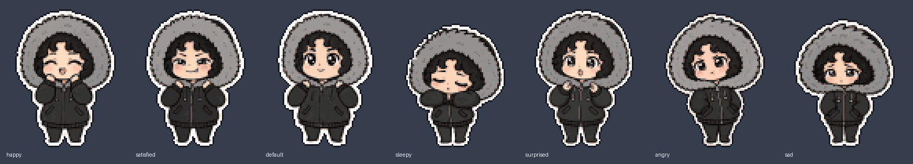
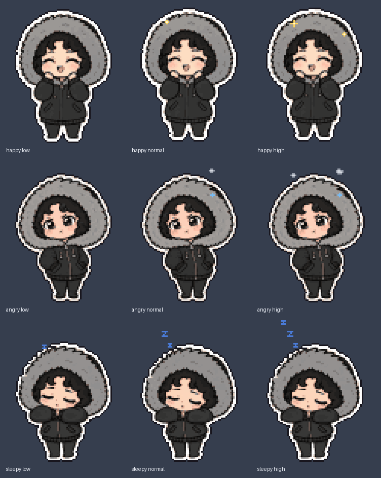
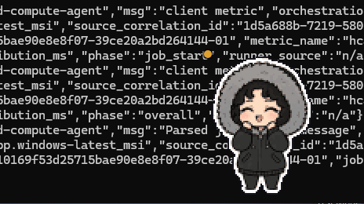

# The JARVIS desktop companion — implementation record (Linux, macOS, Windows)

**Status: built (2026-11-10), draft PR.** This document began as a proposal;
the owner approved its three open decisions and two further boundaries as
**OD-DESK-1…5** (`docs/DECISION_REGISTER.md` §2O). It now records what was
built, what was verified and where, and what remains. Character Activity v1
(OD-CHAR-4, with the strict 30-minute boundary of CHAR-13) is reused unchanged.

## 1. What it is

A small pixel-art JARVIS that sits on the desktop, above other windows where
the platform allows, and presents the same seven expressions the Android
character does: happy, satisfied, default, sleepy, surprised, angry, sad. They
mean the same things (`docs/CHARACTER_PRESENTATION.md`): JARVIS's operational
activity, never a feeling and never anger at the user. **The companion
presents; it never authorizes** (OD-DESK-4) — and the server enforces that,
not only the client (§8).

## 2. What it reuses, unchanged

| Piece | Reused as |
|---|---|
| `GET /api/v1/presentation/activity` | the only data it reads, polled while visible and unlocked |
| `ActivityPresentation` | validated whole twice — in Rust before the IPC boundary, and by the shared JS parser in the page |
| `ActivityPolicy` | a third implementation, `shared/web/activity-policy.js`, held to the shared vectors and replayed against the Python reference |
| `CharacterPresentationSettings` | the shipped defaults (`assets/character/presentation.json`), vendored at build time; poll interval 15 s, max age 60 s |
| intensity | the same 1–10 mapping; on desktop it only selects an animation band |
| the 30-minute window | untouched: the server scorer is not modified |

A task started on the phone moves the desktop character too: the report is per
user (`tests/integration/test_desktop_scope.py`).

## 3. Architecture

```
 Rust core (desktop/src-tauri)                                  webview (desktop/src, no framework)
 ────────────────────────────                                   ──────────────────────────────────
 OS credential store ─ Ed25519 key ─▶ device proof ─▶ access token (memory only)
                                       │
 reqwest (origin-pinned, no redirects) ─▶ GET /presentation/activity
 ActivityReport::parse (strict) ─▶ canonical JSON ──── event "activity" ──▶ parseActivityReport ─▶ ActivityPolicy
 lock / sleep / show / click events ───────────────── event "local-activity" ─▶        │
 tray + in-window menu, window, autostart, browser                                  SpriteAnimator ─▶ canvas
```

| Rust core owns | Webview owns |
|---|---|
| sign-in (system browser + loopback + PKCE), device registration, the key in the OS store, token minting and re-minting, revocation handling, sign-out | report parsing (again), the ActivityPolicy, expression and intensity, the sprite animator and renderer |
| every HTTPS request; polling and its lifecycle (visible, unlocked, signed in, backoff) | the settings form |
| tray, windows, click-through, size, start at login, single instance, opening the browser | — |
| local non-secret preferences (`prefs.json`) | — |

**IPC allowlist.** Two windows, two capability files, nothing else
(`desktop/src-tauri/capabilities/`):

| Window | May call | Plus |
|---|---|---|
| `companion` | `companion_ready`, `companion_status` (smoke test only), `open_jarvis`, `show_menu`, `start_drag` | listen/unlisten to events |
| `settings` | `settings_get`, `settings_set`, `sign_in`, `sign_out` | listen/unlisten to events |

No HTTP, filesystem, shell, opener, clipboard, dialog or window-management
permission; no `core:default`. Each command also checks its window label. The
CSP gives the pages no `connect-src` beyond Tauri's IPC, so a page cannot make
a network request even to its own origin; the JSON it needs is compiled into
ES modules at build time. No command accepts or returns a token, key, code,
verifier or proof. Pinned by `src/tests.rs` (capabilities, handler list,
command types, CSP) and `desktop/src/test/boundary.test.mjs` (no `fetch`,
storage, clipboard or `eval` in any page script; each page invokes only its
own window's commands).

## 4. Device identity and sign-in (OD-DESK-1)

```
 companion                               server                                   browser
 verifier, state (random, memory only)
 GET /auth/oidc/start?desktop_state&desktop_challenge=S256(verifier)&desktop_port
                                         stores them on the login state  ───────▶ Google
                                         ◀──────────────────────────────────────── /auth/oidc/callback
                                         all 03 §2.3 checks → handoff code (hash stored, 120 s, single use)
                                         302 http://127.0.0.1:<port>/jarvis/callback?code&state
 loopback listener: state equal? (constant time; wrong ones ignored, no script in its page)
 POST /auth/desktop/handoff {code, code_verifier} → bootstrap token bound to `desktop`
 Ed25519 key generated locally → OS credential store
 POST /devices {platform: desktop, public_key, key_proof}   (existing 03 §3)
 POST /sessions/token {device_credential: proof}             (existing 03 §5; 15-min token, memory only)
```

* **No bearer credential in a URL.** The only thing in the browser is the
  handoff code, worthless without the verifier. Bootstrap and access tokens
  travel only in bodies between the companion and the server.
* **Login injection** fails twice: the companion checks its own state, and a
  code from someone else's login was bound to someone else's challenge.
* **Platform binding both ways:** a handoff token registers only a desktop; a
  desktop registers only with one, and only with its own key.
* **Refresh** is the existing device proof — there is no refresh token to
  store. A `401` on minting means the device is revoked or the user inactive:
  the companion destroys its local key and returns to signed-out.
* **Key storage:** macOS Keychain, Windows Credential Manager, Linux Secret
  Service (GNOME Keyring, KDE Wallet), through the `keyring` crate. A probe
  write runs *before* anything is registered; no store → sign-in refuses, and
  nothing is written anywhere else. **This is software key storage protected
  by the OS account, not Secure Enclave or TPM hardware binding.**
* **Sign-out:** revokes this device on the server (`DELETE /devices/{own id}`)
  when reachable, and always destroys the local key and token. Offline, the
  settings page says the device is still listed and should be revoked from the
  phone (`GET /devices` shows it with `platform: desktop`).
* **Server address:** configured by the user (no built-in URL). HTTPS, or
  plain HTTP only on loopback for development; an origin only (no path, query,
  fragment or credentials). The HTTP client never follows redirects, so an
  `Authorization` header cannot be forwarded to another origin; bodies are
  capped at 64 KB; timeouts 8 s connect / 20 s total.
* **Server switch:** `desktop.enabled` (default off). An operator turns it on
  in `config.yaml`:

  ```yaml
  desktop:
    enabled: true
  ```

## 5. Pixel-art character (OD-DESK-2)





An animated preview of all seven idling is `images/desktop/idle.gif`
(regenerate the previews with `python desktop/art/preview.py`).

* **Source:** the seven approved drawings in `assets/character/default/`,
  read only. `desktop/art/generate_sprites.py` removes the decoration that is
  not the character (the drawing's own "Zzz" — the companion animates its
  own), area-downsamples to a **64×88** sprite (the drawings are portrait,
  aspect ≈ 0.72), binarises alpha, quantises all seven to **one shared
  palette** (36 colours, over-sampling the small saturated details — blush,
  mouth, tears — that carry the expression), and adds a 1 px dark outline
  outside the white sticker rim so the character reads on any wallpaper.
  Feature anchors (eye boxes, tear origin, a 5-pixel bubble-edge cleanup) are
  hand-authored data in `desktop/art/rig.json`. 48×64 was tried and rejected:
  angry brows and tears were lost.
* **Frame:** 80×96 (headroom for particles and hops). Sizes 2× / 3× / 4×
  (160×192 → 320×384 CSS px; default 2×). On screen each sprite pixel is a
  whole block of device pixels — `round(scale × devicePixelRatio)` — with
  `imageSmoothingEnabled = false`.
* **Animations** (100 unique frames, 42 animations in
  `desktop/src/sprites/jarvis-atlas.png` + `.json`):

  | Per expression | Frames | Notes |
  |---|---|---|
  | `idle_<e>_low` / `idle_<e>` / `idle_<e>_high` | 6–7 | intensity 1–3 / 4–7 / 8–10: amplitude 0/1/2 px, speed 0.75×/1×/1.25×, particles off/some/more |
  | `to_<e>` | 3 | squash → stretch → settle |
  | `long_idle_<e>` | 7–10 | once after ten minutes without a change: a stretch, and blinks |
  | `static_<e>` | 1 | reduced motion / fallback |

  Motion styles: happy bounces with sparkles; satisfied sways; default
  breathes and blinks; sleepy nods under rising pixel z's; surprised hops with
  a small "!"; **angry shakes with steam and a sweat drop — workload, never
  aimed at anyone**; sad droops with a falling tear. Open-eyed states blink.
* **Reduced motion** (`always`, or the OS's `prefers-reduced-motion`): the
  correct expression's first idle frame, still; no transitions, pokes or long
  idle. **Hidden:** no timer runs and nothing is drawn.
* **Fallbacks:** an animation the atlas lacks → `idle_default`; an atlas that
  fails validation or does not load → `jarvis-fallback.png` (a single
  `default` frame).
* **Reproducibility:** `generate_sprites.py --check` regenerates in memory and
  compares pixels (CI, with `Pillow==12.3.0`, `numpy==2.4.6`); every file is
  pinned in `desktop/art/SHA256SUMS`, which the frontend build verifies.

## 6. Per-platform behaviour and limits

What the code does, and what was **actually verified**. "CI" means a GitHub
Actions runner smoke-testing the installed package (§9); a smoke test proves
the packaged webview loads the atlas, runs the shared policy on a synthetic
report and shows the expected expression, and that the transparent window and
tray are created. It does not prove how a particular window manager stacks or
composites the window.

| | Windows 10/11 | macOS 11+ | Linux X11 | Linux Wayland |
|---|---|---|---|---|
| Webview | WebView2 (bootstrapper in the MSI) | WKWebView | WebKitGTK 4.1 | WebKitGTK 4.1 |
| Transparent, frameless, no shadow | requested | requested, via `macOSPrivateApi` (hence no Mac App Store) | requested; needs a compositor — without one, turn on **Backdrop** | requested (compositors always composite) |
| Always on top | `set_always_on_top` | floating level, on all Spaces | EWMH `_NET_WM_STATE_ABOVE` (WM-dependent) | **not promised**: no standard protocol; GNOME ignores it |
| Drag | `start_dragging` | same | same | compositor moves it |
| Remembers position | yes, only onto a monitor still present | yes | yes | **no** (an app cannot read or set its global position) |
| Click-through | `set_ignore_cursor_events` | same | same (input shape) | compositor-dependent |
| Escape from click-through | tray, Settings, **or launching the app again** (single instance turns it off and opens Settings) | same | same | same |
| Tray | notification area | menu bar | StatusNotifier/AppIndicator | same; **GNOME needs an extension** — right-click the character (or its ⋯ button) for the same menu |
| No taskbar/Dock entry | `skipTaskbar` | `Accessory` policy | `skipTaskbar` (WM) | compositor |
| Start at login | opt-in, off | opt-in (LaunchAgent) | opt-in (autostart entry) | same |
| Screen-lock detection | WTS session state | `CGSessionCopyCurrentDictionary` | logind `LockedHint` | same |
| Package | MSI | DMG | `.deb`, AppImage | same |

**Linux policy.** The session is detected (`XDG_SESSION_TYPE`,
`WAYLAND_DISPLAY`, `GDK_BACKEND`) and Settings states what this session can
and cannot do. The companion never switches itself to XWayland;
`GDK_BACKEND=x11` is a documented opt-in. Some NVIDIA + WebKitGTK setups
render blank: start it with `WEBKIT_DISABLE_DMABUF_RENDERER=1`. Flatpak is
deferred. wlr-layer-shell (true always-on-top on wlroots) is not implemented.

### Verification record (2026-11-10)

Every row below is a smoke test of the **installed or packaged** artifact
(`.github/workflows/desktop.yml`, run `42880814824` on commit `7a20b71`, all
jobs green), except the first. Each smoke result was `ok: true`: atlas loaded
(`renderer: true`), the policy chose `happy` at intensity 8 for the synthetic
report (score 9, threshold 7 → intensity 8), window and tray created.

| Environment | Artifact | Smoke | What the screenshot shows |
|---|---|---|---|
| macOS 26, Apple silicon (local) | `.app` launched from the mounted DMG | passed | none — no Screen Recording permission in that session |
| macOS, `macos-latest` runner | app launched from the mounted DMG | passed | **transparent**: the character over the desktop with no window background (`images/desktop/ci-macos-dmg.png`) |
| Windows Server 2025, `windows-latest` | MSI installed with `msiexec /qn`, the installed exe run | passed | **transparent and on top**: the character above a console window, its text visible around the sprite (`images/desktop/ci-windows-msi-on-top.png`); the installer's desktop shortcut present |
| Ubuntu 22.04 and 24.04, X11 (Xvfb) **with** a compositor (`xcompmgr`) | `.deb` installed | passed | **transparent**, on-screen bottom-right (`images/desktop/ci-linux-x11-composited.png`) |
| Ubuntu 22.04 and 24.04, X11 (Xvfb) **without** a compositor | `.deb` installed | passed | placed on-screen; the root is black, so transparency cannot be judged — without a compositor X11 draws it black (use Backdrop) |
| Ubuntu 22.04 and 24.04, **Wayland** (headless Weston) | `.deb` installed | passed (`session: wayland`) | not captured; stacking and position are the compositor's |
| Ubuntu 22.04, X11 (Xvfb) | AppImage (extract-and-run) | passed | — |





Found and fixed by these runs: on Linux the window opened mostly off-screen
(the default placement read the window's size before it was mapped); Windows
checkouts converted the pinned atlas JSON to CRLF (now `-text` in
`.gitattributes`).

**Not verified anywhere:** GNOME Wayland (Mutter), KDE Wayland, Sway/wlroots,
a real tray host on Linux (the runners have no StatusNotifier watcher — the
tray *object* was created, nobody displayed it), always-on-top under a real
X11 window manager, click-through and dragging (the smoke test does not move
the pointer), multi-monitor and mixed-DPI hardware, Windows 10 without
WebView2, Intel macOS (the CI DMG is Apple-silicon; the release workflow
builds a universal DMG, not yet run), and any signed or notarized build
(no credentials configured). Sign-in against a real Google login was not run:
the protocol is covered by the server tests and by the Rust client tests
against a mock server.

## 7. Interaction

| Input | Does |
|---|---|
| Single click | local activity (wakes a `sleepy` the report alone would keep) and a small hop on the current expression |
| Double click / "Open JARVIS" | opens the configured JARVIS web page in the browser — by default the server's `/ui/`, which is the **Intelligence Workbench, a configuration page, not a chat**; JARVIS has no web conversation page yet. No token is passed to the browser |
| Drag | moves the companion |
| Right-click / ⋯ button | the menu (the fallback where there is no tray) |
| Tray / menu | Show/Hide · Open JARVIS · Sign in / Sign out · Click-through · Size 2×/3×/4× · Reduced motion · Start at login (off) · Settings… · Quit |
| Lock / sleep | polling stops; on unlock or wake, local activity and one fresh request |

Never: approve, confirm, cancel, submit or modify a task; read the clipboard,
screen, keystrokes or other windows; install global input hooks; record
audio; speak; play sound. Status and task outcomes stay in JARVIS's status
interfaces — the character is decorative and smoothed by design.

## 8. Security and privacy

* **Server-enforced scope (OD-DESK-1/4).** Every authenticated HTTP request
  passes `server/gateway/device_scope.py`: a desktop session reaches the three
  routes marked `@desktop_scope` — its activity report, its own logout, its own
  device's revocation — and everything else answers `403` before the handler
  runs (audited `session.device_scope.refused`). An unknown platform reaches
  nothing. The device channel refuses any non-`android` device, so a desktop
  can never become an execution target, receive a reminder or resume a task.
  A stolen desktop key therefore yields at most the user's activity report.
* **No secret leaves Rust.** The webview never holds a token, key, code,
  verifier or proof; the tests sweep the Rust log output of a whole sign-in
  and every request URL for them.
* **Nothing kept (OD-DESK-5).** Reports, scores and expressions stay in memory
  until stale; nothing is logged (the logger is never given them), stored in
  browser storage or written to disk. `prefs.json` holds only the server
  address, the web page, size, motion, click-through, backdrop, visibility,
  start-at-login and (where supported) position; a damaged file is set aside
  and the defaults apply.
* **No emotion inference.** The only local signals are explicit events
  (click, open, unlock, wake). No keystrokes, window titles, clipboard,
  screen or audio.
* **Real data.** Building the companion does not open the real-data gate
  (`docs/RELEASE_VALIDATION.md`).

## 9. Builds, packages and tests

| Where | What |
|---|---|
| `tests/security_core/test_desktop_device.py` | handoff (loopback redirect, no bearer in URL, verifier, single use, expiry, injection, off by default), platform binding, own key, desktop scope (each refused route, audit), device channel refusal, independent revocation, self-revocation only, logout + re-mint, re-registration, nothing secret stored |
| `tests/integration/test_desktop_scope.py` | **every** route of the production composition refuses a desktop token except the three; a task started on the phone moves the desktop's report |
| `tests/presentation/test_activity_policy_js_parity.py` | Python and JS policies agree step by step on 10 000 random steps (valid and malformed reports, five settings) |
| `shared/web/activity-policy.test.mjs` | every policy vector, wire sample and intensity vector; invariants; settings validation |
| `desktop/src/test/*.test.mjs` | atlas pins, frame bounds, palette and hard alpha, all seven expressions' animations, bands, integer scaling, fallbacks, transitions without flicker, reduced motion, hidden, long idle; the webview boundary |
| `desktop/src-tauri` `cargo test` | identity formats against `proof_vectors.json`, origin rules, report validation against the shared samples, loopback listener, keystore, prefs; sign-in/refresh/revocation/sign-out against a mock server; redirect refusal; capability/command/CSP pins |
| `.github/workflows/desktop.yml` | the above on Ubuntu 22.04/latest, macOS and Windows; `tauri build`; smoke tests of the **installed** `.deb` (Xvfb X11; headless Weston Wayland), the AppImage, the app run from the mounted DMG, and the MSI-installed exe, with screenshots; SHA-256 checksums; unsigned artifacts |
| `.github/workflows/desktop-release.yml` | tag `desktop-v*` (must already exist on `main`): every build from the tag's commit, re-checked before and after the draft; signed/notarized builds only when the secrets exist, and a CI-verified signing report in which ad-hoc signatures count as unsigned; checksums; a **draft** GitHub Release. Runbook and checks: `docs/DESKTOP_RELEASE.md`, tested by `tests/foundation/test_desktop_release_integrity.py` |

Run locally:

```bash
cd desktop && npm ci
npm test                                        # policy, renderer, boundary
(cd src-tauri && cargo test)                    # native core
npx tauri dev                                   # or: npx tauri build
```

## 10. Remaining work and requirements

* **Signing credentials** (repository secrets, never pasted elsewhere):
  `APPLE_CERTIFICATE`, `APPLE_CERTIFICATE_PASSWORD`, `APPLE_SIGNING_IDENTITY`,
  `APPLE_ID`, `APPLE_PASSWORD` (app-specific), `APPLE_TEAM_ID`;
  `WINDOWS_CERTIFICATE`, `WINDOWS_CERTIFICATE_PASSWORD`. Until then every
  artifact is unsigned: macOS Gatekeeper and Windows SmartScreen will warn.
* **Auto-update** (`tauri-plugin-updater`) is not included: it needs its own
  signing key and a decision on the update channel.
* **Manual checks still owed** on real desktops: KDE and wlroots Wayland,
  GNOME with and without an AppIndicator extension, X11 without a compositor
  (Backdrop), Windows 10 without WebView2 preinstalled, multi-monitor at mixed
  DPI, and transparency of the signed DMG.
* **Not built (out of scope):** chat, task submission, confirmations, desktop
  execution adapters (docs/24 remains a proposal), Flatpak, a browser sign-in
  (M3) — the desktop identity does not depend on it.
